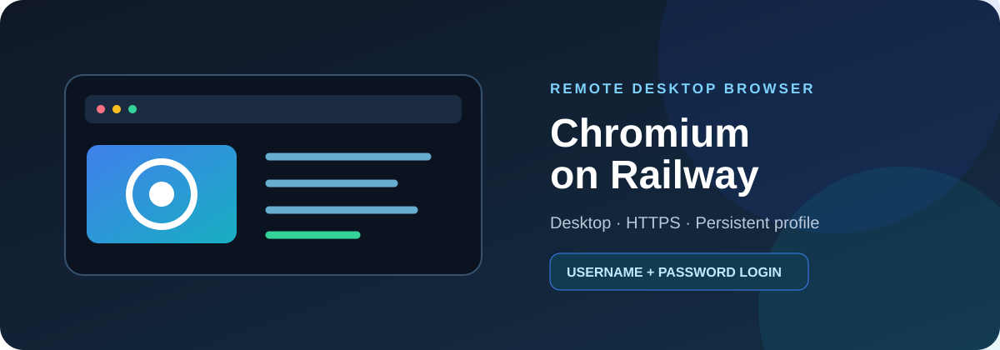
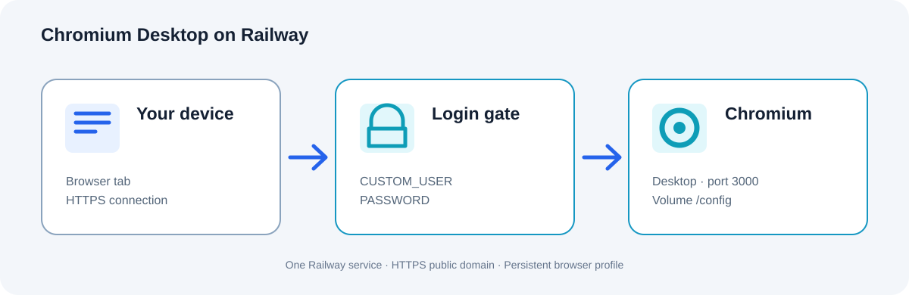

<div align="center">


<h1>Chromium Railway</h1>

<p><a href="https://github.com/DURIAN-ORGANISASI/chromium-railway/actions/workflows/validate.yml"></a> <a href="LICENSE"></a>   </p>

<p><a href="README.md">🇮🇩 Bahasa Indonesia</a> · <a href="README.en.md">🇬🇧 English</a></p>

<p><strong>Run Chromium Desktop on Railway and access it from a browser.</strong><br>
Includes username/password login and a temporary browser profile in the container filesystem.</p>

<p><a href="docs/DEPLOY-RAILWAY.md">📘 Railway deployment guide</a> · <a href="#features">Features</a> · <a href="#railway-variables">Variables</a> · <a href="#deploy-to-railway">Deploy</a> · <a href="#security">Security</a> · <a href="#sources-attribution-and-license">Sources &amp; license</a></p>

</div>


<p align="center"><sub>Documentation artwork — not an official Chromium or Railway screenshot.</sub></p>

> [!IMPORTANT]
> **This repository runs a visual Chromium Desktop session.** Open the Railway domain, enter your username and password, and control the browser directly from your browser tab. It is a visual desktop browser, not a headless browser, and requires no additional service.

> [!WARNING]
> A remote browser gives anyone with the credentials access to the browser session, cookies, signed-in accounts, and profile files. Use a unique strong password. Railway provides HTTPS for generated public domains; do not share the URL or credentials.

## Overview

Chromium runs as a single Docker service on Railway. Its desktop interface is streamed to your browser through the Selkies web client. The browser profile is stored in the container's ordinary filesystem at `/config`, without a Railway Volume. Bookmarks, extensions, cookies, preferences, and saved files remain available while the same container exists, but are lost when Railway recreates the container or replaces the deployment.

| Component | Configuration |
| --- | --- |
| Browser | Chromium Desktop |
| Base image | `lscr.io/linuxserver/chromium:7b8e918f-ls63 (pinned digest)` |
| Internal port | `3000` |
| Access | Railway HTTPS domain |
| Login | `CUSTOM_USER` + `PASSWORD` |
| Browser profile | Temporary container filesystem at `/config` |
| Additional services | None required |

## Features

- **Railway-compatible startup:** a dedicated wrapper starts the upstream s6 service tree without calling `/init` as PID 1, avoiding `s6-overlay-suexec: fatal: can only run as pid 1`.
- **Login before desktop access:** Nginx always requires `CUSTOM_USER` and `PASSWORD`; the password is hashed and removed before desktop processes start.
- **Health check:** an internal `/healthz` endpoint is available for Railway deployment checks.
- **Lightweight default for 1 GB Railway services:** desktop is locked to 1280×720 at 30 FPS to avoid the overhead of a 1920-pixel / 60 FPS software stream.

- **Chromium Desktop:** full visual browser, not headless mode.
- **Access from anywhere:** open the Railway domain in Chrome, Edge, Firefox, or another modern browser.
- **Username/password login:** the web interface is protected by HTTP Basic Authentication.
- **Temporary profile without a Volume:** bookmarks, cookies, extensions, history, settings, and files are stored directly in the container filesystem at `/config`.
- **Keyboard, mouse, and clipboard:** control Chromium from desktop or mobile devices.
- **File upload/download:** use the Selkies sidebar when file transfer is enabled.
- **Hardened desktop mode:** `HARDEN_DESKTOP=true` disables the desktop terminal and sudo.
- **Single service:** no database, Redis, or API key is required.

## Railway Variables

Open **Railway → Chromium → Variables**. Paste the block below and replace the example username and password:

```dotenv
CUSTOM_USER=chromium
PASSWORD=REPLACE_WITH_A_UNIQUE_PASSWORD_AT_LEAST_12_CHARACTERS
PORT=3000
TZ=Asia/Jakarta
HARDEN_DESKTOP=true
RAILWAY_SHM_SIZE_BYTES=1073741824
```

| Variable | Required | Purpose |
| --- | --- | --- |
| `CUSTOM_USER` | Yes | Username for the Chromium web login. Use letters, digits, period, underscore, `@`, or hyphen. |
| `PASSWORD` | Yes | Login password. Use at least 12 characters and a unique password. |
| `PORT` | Yes | Internal desktop web port. Keep `3000`. |
| `TZ` | Optional | Container timezone. Default is `Asia/Jakarta`. |
| `HARDEN_DESKTOP` | Optional | `true` disables the desktop terminal and sudo. Dockerfile default is `true`. |
| `RAILWAY_SHM_SIZE_BYTES` | Recommended | Container shared memory in bytes. `1073741824` = 1 GiB. |

**Username format:** use letters/numbers plus `.`, `_`, `@`, and `-`. Examples: `chromium.admin` or `browser_user`.

**Do not use the example password.** Create a long, unique password. Never store live credentials in GitHub, the README, public screenshots, or commits.

## Deploy to Railway

### 1. Upload the repository to GitHub

1. Create a new repository, for example `DURIAN-ORGANISASI/chromium-railway`.
2. Upload the complete contents of this ZIP to the `main` branch.
3. Make sure `Dockerfile` is in the repository root.

### 2. Create a Railway service

1. Open Railway and create a new project or select an existing project.
2. Choose **New → GitHub Repo**.
3. Connect the `chromium-railway` repository.
4. Leave **Root Directory** empty.
5. Make sure Railway uses the root Dockerfile.
6. Name the service `chromium`.

### 3. Add Variables

Open Chromium service → **Variables** → **RAW Editor**, then paste:

```dotenv
CUSTOM_USER=chromium
PASSWORD=REPLACE_WITH_A_UNIQUE_PASSWORD_AT_LEAST_12_CHARACTERS
PORT=3000
TZ=Asia/Jakarta
HARDEN_DESKTOP=true
RAILWAY_SHM_SIZE_BYTES=1073741824
```

Replace `CUSTOM_USER` and `PASSWORD` with your own values. Deploy/redeploy after saving the variables.

### 4. Use the ordinary container filesystem

Do not create a Railway Volume and do not mount external storage at `/config`. Chromium uses the `/config` directory in the container's normal writable filesystem. The profile is temporary and is reset when Railway recreates the container or replaces the deployment.

### 5. Configure Networking

1. Open **Settings → Networking** on the Chromium service.
2. Select **Generate Domain**.
3. Make sure the domain target port is `3000`.
4. Save and wait for the deployment to become active.

Railway handles HTTPS for domains generated through Networking. The Chromium application inside the container listens on internal port `3000`.

### 6. Sign in to Chromium

1. Open the Railway domain.
2. Your browser will show a login prompt.
3. Enter the `CUSTOM_USER` value as the username.
4. Enter the `PASSWORD` value as the password.
5. Once authenticated, the Chromium desktop appears on the page.

You can browse websites, create bookmarks, install extensions, sign in to websites, and use the Selkies sidebar for keyboard, clipboard, and file transfers.

## Architecture



| Path | Purpose |
| --- | --- |
| `Dockerfile` | Digest-pinned LinuxServer Chromium image with a Railway-specific entry point. |
| `services/browser/railway-start.sh` | Prepares login and starts the s6 service tree without the PID 1 conflict. |
| `services/browser/patch-image.sh` | Enables Nginx authentication, Origin protection, security headers, and `/healthz` at build time. |
| `services/browser/pkg-restore.sh` | Restores requested extra packages from service Variables. |
| `docker-compose.yml` | Runs Chromium locally for testing. |
| `.env.example` | Local environment template without an active password. |
| `docs/DEPLOY-RAILWAY.md` | Step-by-step Railway deployment guide. |
| `docs/SOURCES.md` | Upstream references, attribution, and licensing. |
| `SECURITY.md` | Security policy and credential guidance. |
| `scripts/validate_repo.py` | Checks repository structure and documentation. |

## Run locally with Docker

Make sure Docker Desktop or Docker Engine is running. Then run:

```bash
cp .env.example .env
```

Edit `.env` and replace `PASSWORD`, then run:

```bash
docker compose up -d --build
```

Open `http://localhost:3000` and sign in with the username and password from `.env`. The browser profile is stored in the container filesystem at `/config`; it is temporary and disappears when the container is recreated.

## Troubleshooting

| Issue | Check |
| --- | --- |
| Domain does not open | Check deployment status and the `3000` target port in Networking. |
| Login prompt keeps appearing | Verify `CUSTOM_USER` and `PASSWORD` in Variables, then redeploy. |
| Blank browser desktop | Wait for the desktop session to initialize, then refresh. Check Deploy Logs if it remains blank. |
| Browser crashes frequently | Start with one tab, allocate sufficient service RAM, and keep shared memory at `1 GiB`. |
| Bookmarks/cookies disappear after redeployment | This is expected without a Volume. The browser uses temporary container storage, so the profile is not preserved when the container is recreated. |
| Upload/download menu is missing | Open the Selkies sidebar and check whether file transfer is enabled in the image configuration. |
| Websites are slow | Rendering uses CPU rather than a GPU. WebGL, 3D games, and high-resolution video may be slower. |

## Security

- Use a unique password of at least 12 characters; longer is better.
- Do not share the browser domain, username, password, or session.
- Access the browser through the Railway HTTPS domain, not an unencrypted public HTTP endpoint.
- Keep `HARDEN_DESKTOP=true` to disable the desktop terminal and sudo.
- The browser stores cookies, signed-in sessions, and website passwords in `/config`. This data is in the temporary container filesystem, not persistent storage.
- Avoid signing in to sensitive accounts on shared devices unless you clear the session afterward.
- Avoid downloading or opening untrusted files. Anyone who can sign in can control the browser.
- `CUSTOM_USER` and `PASSWORD` provide one basic authentication layer, not multi-user accounts or SSO. For organizational access, add an authentication gateway such as Cloudflare Access in front of the domain.

See [SECURITY.md](SECURITY.md) for the full policy.

## Development and validation

Run local checks:

```bash
python scripts/validate_repo.py
```

GitHub Actions checks documentation, repository structure, JSON, and SVG files on pushes and pull requests. The workflow is not a live test of Railway or every browser feature.

## Sources, attribution, and licensing

See [`docs/SOURCES.md`](docs/SOURCES.md) and [`NOTICE.md`](NOTICE.md) for upstream references, attribution, and licensing boundaries.

- **Original documentation and artwork:** MIT; see [`LICENSE`](LICENSE).
- **Integrated Dockerfile and Railway compatibility code in `services/browser/`:** GPL-3.0-or-later; see [`LICENSES/GPL-3.0-or-later.txt`](LICENSES/GPL-3.0-or-later.txt) and [`NOTICE.md`](NOTICE.md).
- **Chromium image:** uses the community image `lscr.io/linuxserver/chromium:7b8e918f-ls63 (pinned digest)`, built on the LinuxServer Chromium/Selkies ecosystem. The image and its components remain under their respective licenses.
- **Chromium and dependencies:** have their own licenses and third-party notices. This repository license does not change upstream licensing.
- **Third parties:** Railway, Docker, LinuxServer, Selkies, Chromium, and image publishers are subject to their respective terms.

This is an independent project and is not affiliated with or officially endorsed by Chromium, Google, LinuxServer.io, Selkies, or Railway.

## Contributing

Bug reports and pull requests are welcome. Read [`CONTRIBUTING.md`](CONTRIBUTING.md). Do not include passwords, browser cookies, `.env` files, or personal data in issues or commits.
