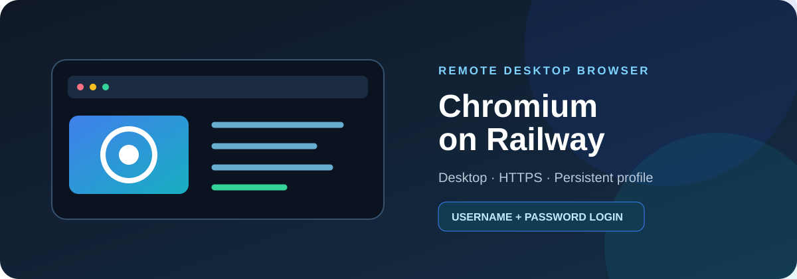
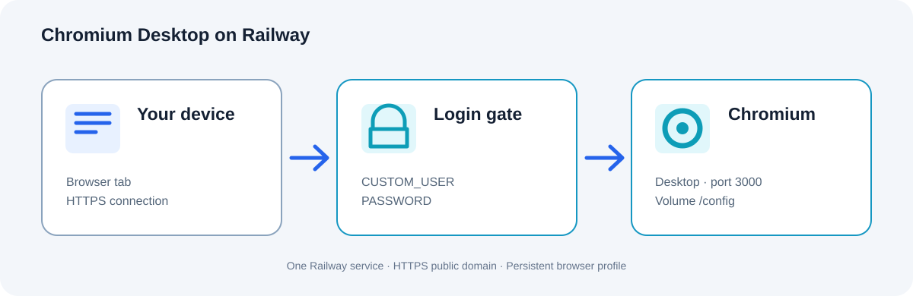

<div align="center">


<h1>Chromium Railway</h1>

<p><a href="https://github.com/DURIAN-ORGANISASI/chromium-railway/actions/workflows/validate.yml"></a> <a href="LICENSE"></a>   </p>

<p><a href="README.md">🇮🇩 Bahasa Indonesia</a> · <a href="README.en.md">🇬🇧 English</a></p>

<p><strong>Jalankan Chromium Desktop di Railway dan akses melalui browser.</strong><br>
Dilengkapi login username/password dan penyimpanan profil browser permanen.</p>

<p><a href="docs/DEPLOY-RAILWAY.md">📘 Panduan deploy Railway</a> · <a href="#fitur">Fitur</a> · <a href="#variables-railway">Variables</a> · <a href="#deploy-ke-railway">Deploy</a> · <a href="#keamanan">Keamanan</a> · <a href="#sumber-atribusi-dan-lisensi">Sumber &amp; lisensi</a></p>

</div>


<p align="center"><sub>Ilustrasi dokumentasi — bukan screenshot resmi Chromium atau Railway.</sub></p>

> [!IMPORTANT]
> **Repository ini menjalankan Chromium Desktop dengan tampilan visual.** Buka domain Railway, masukkan username dan password, lalu kendalikan browser langsung dari tab browser milikmu. Ini adalah browser desktop visual, bukan browser headless; tidak membutuhkan service tambahan.

> [!WARNING]
> Browser jarak jauh memberi pemegang kredensial akses ke sesi browser, cookie, akun yang sedang login, serta file profil. Gunakan password yang unik dan kuat. Railway menyediakan HTTPS untuk domain publik; jangan membagikan URL dan kredensial kepada orang lain.

## Ringkasan

Chromium berjalan di satu Docker service Railway. Antarmuka desktop dikirim ke browser melalui web client Selkies. Volume Railway pada `/config` menyimpan profil browser sehingga bookmark, ekstensi, cookies, pengaturan, dan file yang tersimpan tetap tersedia setelah container restart atau redeploy.

| Komponen | Konfigurasi |
| --- | --- |
| Browser | Chromium Desktop |
| Image dasar | `ghcr.io/two-workspaces/chromium:246dc28` |
| Port internal | `3000` |
| Akses | Domain HTTPS Railway |
| Login | `CUSTOM_USER` + `PASSWORD` |
| Persistent storage | Railway Volume pada `/config` |
| Service tambahan | Tidak diperlukan |

## Fitur

- **Chromium Desktop:** browser lengkap dengan tampilan visual, bukan mode headless.
- **Akses dari mana saja:** buka domain Railway lewat Chrome, Edge, Firefox, atau browser modern lainnya.
- **Login username/password:** akses web browser dilindungi HTTP Basic Authentication.
- **Profil persisten:** bookmark, cookies, ekstensi, riwayat, pengaturan, dan file di `/config` bertahan melalui Railway Volume.
- **Keyboard, mouse, dan clipboard:** kendalikan Chromium dari desktop atau perangkat seluler.
- **Upload/download file:** gunakan panel Selkies bila fitur file transfer diaktifkan.
- **Mode desktop lebih aman:** `HARDEN_DESKTOP=true` menonaktifkan terminal dan sudo di desktop session.
- **Satu service:** tidak memerlukan database, Redis, atau API key.

## Variables Railway

Buka **Railway → Chromium → Variables**. Salin blok berikut, lalu ganti username dan password contoh:

```dotenv
CUSTOM_USER=chromium
PASSWORD=GANTI_DENGAN_PASSWORD_UNIK_MINIMAL_12_KARAKTER
PORT=3000
TZ=Asia/Jakarta
HARDEN_DESKTOP=true
RAILWAY_SHM_SIZE_BYTES=1073741824
```

| Variable | Wajib | Fungsi |
| --- | --- | --- |
| `CUSTOM_USER` | Ya | Username untuk login ke halaman Chromium. Gunakan huruf, angka, titik, garis bawah, `@`, atau tanda hubung. |
| `PASSWORD` | Ya | Password untuk login. Gunakan minimal 12 karakter dan password unik. |
| `PORT` | Ya | Port internal web desktop. Biarkan `3000`. |
| `TZ` | Opsional | Zona waktu container. Default `Asia/Jakarta`. |
| `HARDEN_DESKTOP` | Opsional | `true` menonaktifkan terminal dan sudo pada desktop session. Default `true` pada Dockerfile. |
| `RAILWAY_SHM_SIZE_BYTES` | Disarankan | Shared memory container dalam byte. `1073741824` = 1 GiB. |

**Catatan username:** gunakan format yang didukung image, yaitu huruf/angka serta `.`, `_`, `@`, dan `-`. Contoh: `akun.durian` atau `chromium_admin`.

**Jangan gunakan password contoh.** Buat password sendiri yang panjang dan unik. Jangan menyimpan kredensial sungguhan di GitHub, README, screenshot publik, atau file commit.

## Deploy ke Railway

### 1. Upload repository ke GitHub

1. Buat repository baru, misalnya `DURIAN-ORGANISASI/chromium-railway`.
2. Upload seluruh isi ZIP repository ini ke branch `main`.
3. Pastikan `Dockerfile` berada di root repository.

### 2. Buat service Railway

1. Buka Railway dan buat project baru atau pilih project yang ingin digunakan.
2. Pilih **New → GitHub Repo**.
3. Hubungkan repository `chromium-railway`.
4. Biarkan **Root Directory** kosong.
5. Pastikan Railway menggunakan Dockerfile di root.
6. Beri nama service `chromium`.

### 3. Tempel Variables

Buka service Chromium → **Variables** → **RAW Editor**, kemudian tempel:

```dotenv
CUSTOM_USER=chromium
PASSWORD=GANTI_DENGAN_PASSWORD_UNIK_MINIMAL_12_KARAKTER
PORT=3000
TZ=Asia/Jakarta
HARDEN_DESKTOP=true
RAILWAY_SHM_SIZE_BYTES=1073741824
```

Ganti nilai `CUSTOM_USER` dan `PASSWORD` sesuai keinginan. Klik deploy/redeploy setelah menyimpan Variables.

### 4. Tambahkan Volume

Buka **Volumes → New Volume** pada service Chromium. Atur mount path tepat seperti berikut:

```text
/config
```

Volume ini penting. Tanpa Volume, profil dan file browser dapat hilang saat container dibuat ulang atau redeploy.

### 5. Atur Networking

1. Buka **Settings → Networking** pada service Chromium.
2. Pilih **Generate Domain**.
3. Pastikan target port domain adalah `3000`.
4. Simpan pengaturan dan tunggu deployment aktif.

Railway menangani HTTPS untuk domain yang dibuat melalui Networking. Aplikasi Chromium di container menerima traffic pada port internal `3000`.

### 6. Login ke Chromium

1. Buka domain Railway yang sudah dibuat.
2. Browser akan menampilkan dialog login.
3. Masukkan `CUSTOM_USER` sebagai username.
4. Masukkan `PASSWORD` sebagai password.
5. Setelah berhasil, desktop Chromium akan tampil di halaman tersebut.

Kamu dapat membuka situs, membuat bookmark, memasang ekstensi, login akun website, serta menggunakan menu samping untuk keyboard, clipboard, dan file transfer.

## Arsitektur



| Path | Fungsi |
| --- | --- |
| `Dockerfile` | Menentukan image Chromium yang digunakan dan konfigurasi default. |
| `docker-compose.yml` | Menjalankan Chromium secara lokal untuk pengujian. |
| `.env.example` | Template Variables lokal tanpa password aktif. |
| `docs/DEPLOY-RAILWAY.md` | Panduan deploy langkah demi langkah. |
| `docs/SOURCES.md` | Referensi upstream, atribusi, dan lisensi. |
| `SECURITY.md` | Kebijakan keamanan dan cara menjaga kredensial. |
| `scripts/validate_repo.py` | Pemeriksaan struktur dokumentasi dan konfigurasi repo. |

## Menjalankan secara lokal dengan Docker

Pastikan Docker Desktop atau Docker Engine sudah aktif. Kemudian jalankan:

```bash
cp .env.example .env
```

Edit `.env`, ganti `PASSWORD`, lalu jalankan:

```bash
docker compose up -d --build
```

Buka `http://localhost:3000`, lalu login menggunakan username dan password dari `.env`. Profil browser disimpan di folder `data/`.

## Troubleshooting

| Masalah | Pemeriksaan |
| --- | --- |
| Domain tidak terbuka | Periksa status deployment dan target port `3000` pada Networking. |
| Dialog login terus muncul | Pastikan `CUSTOM_USER` dan `PASSWORD` pada Variables benar, lalu redeploy. |
| Browser tampil kosong | Tunggu sesi desktop siap, lalu refresh halaman. Periksa Deploy Logs jika tetap kosong. |
| Browser sering crash | Mulai dengan satu tab, sediakan RAM service yang memadai, dan pertahankan shared memory `1 GiB`. |
| Bookmark/cookies hilang | Pastikan Railway Volume benar-benar terpasang pada `/config` di service dan environment yang sama. |
| Upload/download tidak muncul | Buka menu samping Selkies dan periksa apakah file transfer diaktifkan oleh konfigurasi image. |
| Website lambat | Rendering memakai CPU, bukan GPU. WebGL, game 3D, dan video beresolusi tinggi dapat lebih lambat. |

## Keamanan

- Gunakan password unik minimal 12 karakter; lebih panjang lebih baik.
- Jangan bagikan domain, username, password, atau sesi browser.
- Akses browser melalui domain HTTPS Railway, bukan HTTP publik yang tidak terenkripsi.
- Biarkan `HARDEN_DESKTOP=true` agar terminal dan sudo desktop session dinonaktifkan.
- Browser menyimpan cookies, sesi login, dan password website di `/config`. Anggap Volume sebagai data sensitif.
- Jangan login ke akun penting dari perangkat bersama tanpa menghapus sesi setelah selesai.
- Hindari mengunduh atau membuka file yang tidak dipercaya. Siapa pun yang berhasil login dapat mengontrol browser.
- `CUSTOM_USER` dan `PASSWORD` merupakan satu lapisan autentikasi dasar, bukan sistem multi-user atau SSO. Untuk akses organisasi, tambahkan gateway autentikasi seperti Cloudflare Access di depan domain.

Baca [SECURITY.md](SECURITY.md) untuk panduan lebih lengkap.

## Pengembangan dan validasi

Jalankan pemeriksaan lokal:

```bash
python scripts/validate_repo.py
```

GitHub Actions memeriksa dokumentasi, struktur file, JSON, dan SVG saat push atau pull request. Workflow validasi bukan pengujian live terhadap server Railway atau seluruh fungsi browser.

## Sumber, atribusi, dan lisensi

Lihat [`docs/SOURCES.md`](docs/SOURCES.md) untuk sumber resmi, atribusi, serta batas lisensi.

- **File repository dan definisi Docker:** MIT, lihat [`LICENSE`](LICENSE).
- **Image Chromium:** menggunakan image komunitas `ghcr.io/two-workspaces/chromium:246dc28`, yang dibuat berdasarkan ekosistem LinuxServer Chromium/Selkies. Image dan seluruh komponennya tetap mengikuti lisensi masing-masing.
- **Chromium dan dependency:** memiliki lisensi serta pemberitahuan pihak ketiga sendiri. Lisensi repository ini tidak mengubah lisensi upstream.
- **Pihak ketiga:** Railway, Docker, LinuxServer, Selkies, Chromium, dan penyedia image mengikuti ketentuan masing-masing.

Proyek ini independen dan tidak berafiliasi dengan atau didukung secara resmi oleh Chromium, Google, LinuxServer.io, Selkies, atau Railway.

## Kontribusi

Bug report dan pull request dipersilakan. Baca [`CONTRIBUTING.md`](CONTRIBUTING.md). Jangan menyertakan password, browser cookies, file `.env`, atau data pribadi dalam issue dan commit.
